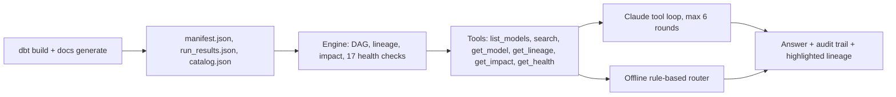

# dbt Copilot

Ask a dbt project about its lineage, model logic and data-quality health in plain English.

**Live demo:** https://fabrice-analytics.com/copilot/ · **Case study:** https://fabrice-analytics.com/dbt-copilot.html

Claude never touches a warehouse or writes SQL. It answers by calling six read-only tools over the project's
`manifest.json` and `run_results.json`, and every answer lists the lookups it made, so you can check it.



## What it answers

- **Lineage:** "What feeds the delinquency mart?"
- **Impact:** "What breaks if I change `stg_harbor__payments`?" (downstream models, exposures, tests)
- **Logic:** "How is `payment_status` calculated?" (the SQL that defines it)
- **Trust:** "Can I trust the executive dashboard?" (its own flags plus every upstream issue)
- **Coverage:** "Which models have no tests?"

## Two modes

| Mode | When | How answers are made |
|---|---|---|
| Claude + tools | The `/api/chat` function is deployed with an API key | Claude chooses tools, reads the results, writes the answer |
| Offline engine | No API, API unreachable, or you loaded your own manifest | Regex intent router over the same tools |

Both modes call the same functions, so the facts are identical; only the wording differs.
**Load your manifest** reads `target/manifest.json` (and optionally `run_results.json`) in the browser. Nothing is uploaded.

## Health checks

Failing or warning tests · failed or skipped runs · exposure downstream of a failure or warning · no tests ·
grain not tested (no unique + not_null key) · missing model description · mostly undocumented columns ·
mart reading a raw source · source feeding marts without freshness · unused staging/intermediate model ·
`select *` in a mart · incremental without `unique_key` · high fan-in · undocumented source.

## Demo project: Harbor Lease

`sample_project/` is a real dbt project on DuckDB for a fictional property manager: 7 sources, 20 models,
37 tests and one exposure. All data is synthetic (`gen_seeds.py`, fixed seed). Problems are planted on purpose:
a failing `accepted_values` test, a warning on null payment methods, a mart that reads a raw source,
an unused untested model, `select *` in an incremental mart, and sources without freshness checks.

```bash
pip install dbt-core dbt-duckdb
cd app && npm run artifacts      # rebuilds the warehouse and src/data/harbor_lease.json
```

## Run locally

```bash
cd app
npm install
npm test          # 49 tests: engine, tool loop (mocked client), API handler, markdown
npm run dev       # UI on http://localhost:5173 (offline mode; vite has no /api)
npx vercel dev    # UI + API, with ANTHROPIC_API_KEY in .env.local
```

## Deploy

**API and app on Vercel** (enables Claude mode)

1. Import the GitHub repo in Vercel and set **Root Directory** to `dbt-copilot/app`. `vercel.json` sets the rest.
2. Environment variables:
   - `ANTHROPIC_API_KEY` (required)
   - `ANTHROPIC_MODEL` (optional, default `claude-haiku-5-5`)
   - `ALLOWED_ORIGINS` (optional, default: fabrice-analytics.com, www, tools subdomain, localhost)
   - `RATE_LIMIT_PER_10MIN` (optional, default 15 per IP)
3. Add the domain `tools.fabrice-analytics.com` and create the CNAME record Vercel shows.
4. Set a monthly spend limit for the key in the Anthropic Console. The in-function rate limit is per instance, so the console limit is the real cap.

**Offline mirror on GitHub Pages**

`npm run build:site` builds the UI into `/copilot/` at the repo root. It probes
`https://tools.fabrice-analytics.com/api/chat` on load, so once the Vercel API is live the Pages copy
switches to Claude mode on its own (override with `VITE_API_URL`).

`api/chat.js` is generated by `npm run build:api` (esbuild) from `server/handler.ts`; edit the TypeScript.

## Layout

```
app/
  src/engine/   project.ts (artifact loader), lineage.ts, health.ts, tools.ts, offline.ts
  src/ui/       React components; md.ts renders a safe markdown subset
  server/       chat.ts (tool loop, validation, rate limiter), handler.ts (Vercel fetch handler)
  api/chat.js   bundled function (generated)
  tests/        vitest
sample_project/ the Harbor Lease dbt project
```
